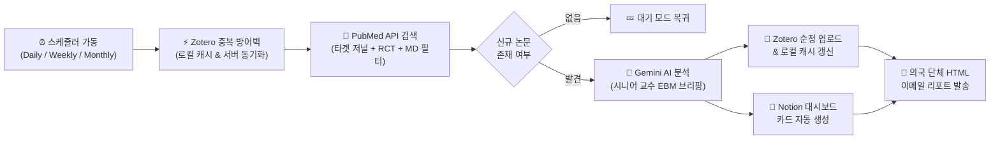

# 🏥 의국 저널 클럽 봇 (Journal Club Bot - EBM Edition)

> **PubMed 최신 임상 논문(RCT) 자동 수집 · Google Gemini 시니어 교수 페르소나 비판적 분석 · Zotero 서지 관리 · Notion 아카이빙 · 의국 단체 이메일 브리핑까지 100% 자동화하는 올인원 Docker 봇**

---

## ✨ 왜 이 봇이 필요한가요?

매주 돌아오는 의국 저널 클럽(Journal Club) 발표를 위해 수많은 저널을 일일이 검색하고, 임상과 무관한 기초/타 직군 논문을 걸러내며, 서지 프로그램(Zotero)과 노션(Notion)에 정리하는 반복 작업을 완전히 자동화합니다.

### 🌟 6대 핵심 기능
1. **🎯 정밀한 임상의(MD) 주도 RCT 논문 필터링 (`fetcher_md.py`)**
   - 지정된 핵심 타겟 저널에서 최신 무작위 대조군 연구(RCT)만 1차 추출합니다.
   - 제1저자 또는 교신저자의 소속(Affiliation)과 학위(MD/DO/MBBS)를 정규식 3단계 필터(전공 키워드 + 의료기관 화이트리스트 + 기초/타 직군 네거티브 필터)로 정밀 검증하여 실제 진료 현장의 의사 주도 논문만 골라냅니다.
2. **🤖 Google Gemini 시니어 교수의 날카로운 EBM 비판적 분석 (`analyzer.py`)**
   - 단순 번역이나 요약이 아닙니다. 근거중심의학(EBM)에 정통한 **의과대학 시니어 교수 페르소나**가 논문의 한 줄 평, 저자 전문성 팩트 체크, **PICO 분석**, **연구 디자인의 치명적 한계(N수, 맹검, 편향)**, **실제 외래/치료실 적용 가능성(MCID, 수가/장비 제약)**을 냉철하게 브리핑합니다.
3. **⚡ Zotero 로컬 캐싱(0.01초) & 순정 메타데이터 업로드 (`zotero_manager.py`)**
   - 의국 공유 Zotero의 `후보(Candidates)` 및 `발표 완료(Presented)` 두 폴더를 대조하여 **한 번 처리된 논문(PMID/DOI)은 영구적으로 중복 수집을 차단**합니다.
   - 로컬 JSON 캐시(`config/zotero_cache.json`)를 통해 평소에는 API 호출 없이 0.01초 만에 중복을 판별하며, 주간/월간 백업 스캔 시 Zotero 서버와 자동 동기화합니다.
4. **📝 Notion 대시보드 자동 디자인 아카이빙 (`notion_manager.py`)**
   - 한/영 노션 데이터베이스 제목 컬럼(`이름`, `Name`, `Title`)을 자동으로 인식(Zero-Config)합니다.
   - 메타데이터 콜아웃 박스, PubMed 북마크, 영문 초록 접기(Toggle) 블록, 영역별 컬러 콜아웃 박스로 시각화된 브리핑 카드를 자동 생성합니다.
5. **📧 모바일/PC 반응형 HTML 단체 이메일 리포트 (`notifier.py`)**
   - 클릭 가능한 상단 목차(TOC), MD 확실성 뱃지, 컬러풀한 브리핑 박스, PubMed 원문 바로가기 버튼이 포함된 깔끔한 HTML 뉴스레터를 의국원 전체에게 발송합니다.
6. **🛡️ 3중 안전망 스케줄러 & 무중단 에러 격리 (`main.py`)**
   - **매일(07:00, 최근 7일) · 매주 일요일(07:10, 최근 30일) · 매월 첫째 주 월요일(07:20, 최근 90일)** 3중 겹침 스캔으로 PubMed 인덱싱 지연으로 인한 누락을 0%로 방어합니다.

---

## 🏗️ 전체 작동 파이프라인



---

## 🚀 빠른 시작 가이드 (Quick Start)

시놀로지 NAS(Container Manager), 일반 리눅스 서버, Windows/Mac Docker Desktop 어디서든 **5분 안에 구동**할 수 있습니다.

### 방법 A. Docker Hub / GHCR 이미지로 즉시 실행하기 (권장)

소스 코드를 직접 빌드할 필요 없이, 아래 3개의 파일(`compose.yaml`, `.env`, `config/settings.yaml`)만 준비하면 바로 실행됩니다.

1. 작업 폴더를 만들고 설정 파일들을 준비합니다:
   ```bash
   mkdir -p journal-club-bot/config journal-club-bot/logs
   cd journal-club-bot
   ```
2. `.env.example`을 참고하여 `.env` 파일을 생성하고 본인의 API 키를 입력합니다.
3. `config/settings.yaml`에 원하는 타겟 저널 목록을 작성합니다.
4. 컨테이너를 백그라운드로 실행합니다:
   ```bash
   docker compose up -d
   ```

### 방법 B. GitHub 저장소 복제 후 직접 빌드하기

```bash
git clone https://github.com/YOUR_USERNAME/journal-club-bot.git
cd journal-club-bot
cp .env.example .env
# .env 파일에 API 키 입력 후 실행
docker compose up -d --build
```

---

## 🔑 환경 변수(`.env`) 설정 가이드

`.env.example` 파일을 복사해 `.env` 파일을 만들고 아래 항목을 채워주세요.

| 변수명 | 필수 여부 | 설명 및 발급 방법 |
| :--- | :---: | :--- |
| `EMAIL` | 필수 | 발송자 이메일 주소 (예: `your_id@gmail.com`) 및 PubMed API 식별용 이메일 |
| `EMAIL_PASSWORD` | 필수 | Gmail **16자리 앱 비밀번호** (구글 계정 관리 → 보안 → 2단계 인증 → 앱 비밀번호에서 발급) |
| `EMAIL_TO` | 선택 | 리포트를 받을 수신자 목록. 여러 명일 경우 콤마(`,`)로 구분 (미입력 시 `EMAIL` 본인에게 발송) |
| `GEMINI_API_KEY` | 필수 | [Google AI Studio](https://aistudio.google.com/)에서 발급받은 Gemini API 키 |
| `GEMINI_MODEL` | 선택 | 사용할 AI 모델명 (기본값: `gemini-3.6-flash`) |
| `ZOTERO_USER_ID` | 필수 | [Zotero Settings > Keys](https://www.zotero.org/settings/keys)에 표시되는 숫자 User ID |
| `ZOTERO_API_KEY` | 필수 | Zotero에서 생성한 Private Key (읽기/쓰기 권한 체크) |
| `ZOTERO_CANDIDATES_ID` | 필수 | 신규 후보 논문이 업로드될 Zotero 컬렉션(폴더)의 8자리 고유 키 (웹 Zotero에서 폴더 클릭 시 URL 끝 8자리) |
| `ZOTERO_PRESENTED_ID` | 필수 | 이미 발표 완료된 논문이 모여 있는 Zotero 컬렉션(폴더)의 8자리 고유 키 |
| `NOTION_API_KEY` | 필수 | [Notion 내 통합(Integrations)](https://www.notion.so/my-integrations)에서 발급받은 `ntn_...` 토큰 |
| `NOTION_DATABASE_ID` | 필수 | 논문이 저장될 노션 데이터베이스의 32자리 ID (해당 노션 페이지 우측 상단 `...` → `연결 추가`에서 봇 연결 필수!) |
| `NCBI_API_KEY` | 권장 | [NCBI 계정 설정](https://www.ncbi.nlm.nih.gov/account/settings/)에서 발급 (초당 요청 한도를 3회 → 10회로 상향) |

---

## 🩺 다른 진료과 / 연구실 맞춤형 커스터마이징 (`config/settings.yaml`)

기본값은 **재활의학과(PM&R)** 주요 19개 저널 및 재활의학과 전문의 필터로 세팅되어 있습니다.  
**정형외과, 신경과, 내과, 마취통증의학과 등 다른 진료과**에서 사용하시려면 `config/settings.yaml`만 수정하시면 됩니다!

```yaml
target_journals:
  - "New England Journal of Medicine"
  - "Lancet"
  # 원하는 PubMed 등재 저널명을 자유롭게 추가/주석(#) 처리하세요.

# 타 진료과 적용 시 아래 주석을 해제하고 키워드와 페르소나를 변경하세요.
filter_options:
  strict_md_filter: true   # false로 설정하면 저자 소속 필터 없이 모든 RCT 논문을 수집합니다.
  specialty_keywords:
    - "neurology"
    - "neurological"
    - "stroke"

custom_persona: >
  당신은 Evidence-Based Medicine(EBM)에 정통한 대한민국 최고 수준의 신경과 시니어 전문의이자 의과대학 교수입니다.
  후배 전공의들의 저널 클럽 발표를 위해 최신 논문을 매우 비판적이고 날카로운 시각으로 분석하세요.
```

---

## 🛠️ 수동 실행 및 관리 명령어 (`run_manual.py`)

정규 스케줄(매일 아침 7시)을 기다리지 않고 지금 즉시 테스트하거나 과거 논문을 대량으로 수집하고 싶을 때 사용합니다.

```bash
# 1. [Dry-Run 테스트] Zotero/Notion 업로드와 메일 발송 없이 터미널에서 AI 분석 결과만 미리보기
docker exec -it journal-club-bot python src/run_manual.py --days 7 --dry-run

# 2. [즉시 수동 실행] 최근 14일 치 신규 논문을 찾아 즉시 Zotero/Notion 업로드 및 이메일 발송
docker exec -it journal-club-bot python src/run_manual.py --days 14

# 3. [대규모 과거 논문 싹쓸이] 최근 365일 치 논문을 Zotero/Notion에 아카이빙하되 이메일 폭탄만 방지(--no-email)
docker exec -it journal-club-bot python src/run_manual.py --days 365 --no-email

# 4. [Zotero 캐시 강제 동기화] Zotero 웹/앱에서 직접 추가한 논문 목록을 로컬 캐시와 즉시 동기화(--sync)
docker exec -it journal-club-bot python src/run_manual.py --days 7 --sync
```

---

## 📂 폴더 구조

```text
journal-club-bot/
├── compose.yaml              # Docker Compose 실행 설정 파일
├── Dockerfile                # 컨테이너 빌드 정의서 (KST 타임존 & Healthcheck 내장)
├── requirements.txt          # Python 필수 패키지 목록
├── .env.example              # 환경변수 템플릿 파일
├── config/
│   ├── settings.yaml         # 타겟 저널 리스트 및 진료과 필터/페르소나 설정
│   └── zotero_cache.json     # (자동 생성) Zotero 영구 중복 방지 로컬 캐시
├── logs/
│   └── system.log            # (자동 생성) 5MB 순환 시스템 로그
└── src/
    ├── main.py               # 24/365 스케줄러 및 파이프라인 오케스트레이터
    ├── run_manual.py         # CLI 수동 실행 및 Dry-Run 테스트 도구
    ├── fetcher_md.py         # PubMed API 배치 수집 및 3단계 MD/RCT 정규식 필터
    ├── analyzer.py           # Google Gemini AI 시니어 교수 비판적 논문 분석기
    ├── zotero_manager.py     # Zotero API 연동 및 로컬 캐시 매니저
    ├── notion_manager.py     # Notion API 블록 디자인 조립 및 분할 업로더
    └── notifier.py           # 반응형 HTML 이메일 리포트 생성 및 SMTP 발송기
```

---

## 📜 라이선스 (License)
이 프로젝트는 [MIT License](./LICENSE)에 따라 자유롭게 사용, 수정 및 배포할 수 있습니다.
