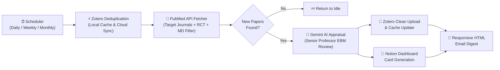

# 🏥 Medical Journal Club Bot (EBM Edition)

> 🌐 **Language**: **English** | [한국어 가이드 (Korean)](./README.ko.md)

[](https://github.com/mingil/journal-club-bot/actions/workflows/docker-publish.yml)
[](https://hub.docker.com/r/kimmingil/journal-club-bot)
[](./LICENSE)

> **An all-in-one autonomous Docker bot for hospital departments and medical research labs: Automated PubMed RCT harvesting, Google Gemini Senior Professor EBM critical appraisal, Zotero bibliography management, Notion dashboard archiving, and responsive HTML email newsletters.**

---

## ✨ Why Journal Club Bot?

Preparing for weekly medical department Journal Clubs often involves repetitive manual searches across dozens of journals, filtering out non-clinical or non-physician noise, importing references into Zotero, and summarizing abstracts into Notion. **Journal Club Bot automates this entire workflow 24/7.**

### 🌟 6 Key Features

1. **🎯 Strict Physician (MD) & RCT Precision Filtering (`fetcher_md.py`)**
   - Automatically queries PubMed (`NCBI Entrez`) across your curated list of target journals specifically for **Randomized Controlled Trials (RCTs)**.
   - Applies a 3-stage regex verification pipeline on the first and last (corresponding) authors' affiliations and credentials (`MD`, `DO`, `MBBS`):
     - *Stage 1*: Specialty keyword matching (default: Physical Medicine & Rehabilitation / PM&R, fully customizable for any specialty).
     - *Stage 2*: Clinical & medical institution whitelist (`Hospital`, `School of Medicine`, `Medical Center`, etc.).
     - *Stage 3*: Negative filtering to exclude non-physician basic science or allied health-only papers unless explicitly led by an MD.
2. **🤖 Senior Professor EBM Critical Appraisal via Google Gemini (`analyzer.py`)**
   - Powered by **Google Gemini (`gemini-3.6-flash` by default)** with a specialized Evidence-Based Medicine (EBM) Senior Medical Professor persona.
   - Generates a structured, critical briefing:
     - **🎯 One-Line Takeaway**: Core clinical value at a glance.
     - **🧑‍⚕️ Author Credibility Check**: Verifies whether the study was genuinely led by practicing physicians in a clinical setting.
     - **📊 PICO Fact Check**: Patient, Intervention, Comparison, and Outcomes (including primary endpoints & p-values).
     - **🧐 Critical Appraisal**: Strengths and fatal methodological flaws (sample size, blinding failures, selection bias, short follow-up).
     - **🏥 Real-World Clinical Implication**: Evaluates Minimal Clinically Important Difference (MCID), equipment/cost constraints, and immediate applicability in outpatient clinics.
3. **⚡ Sub-Millisecond Zotero Deduplication & Clean Metadata Sync (`zotero_manager.py`)**
   - Acts as the **Single Source of Truth** against duplicate papers by tracking both `Candidates` and `Presented` Zotero collections via `PMID` and normalized `DOI`.
   - Uses a persistent local cache (`config/zotero_cache.json`) for **0.01-second deduplication** on daily runs, while automatically re-synchronizing with the remote Zotero server during weekly and monthly backup scans.
   - Uploads clean, standard bibliographic metadata directly to your Zotero `Candidates` collection.
4. **📝 Zero-Config Notion Dashboard Archiving (`notion_manager.py`)**
   - Automatically detects your Notion database's title property (`Name`, `Title`, `이름`) with zero manual schema configuration.
   - Builds rich Notion pages featuring metadata callouts, PubMed web bookmarks, collapsible toggle blocks for the original English abstract, and color-coded callout boxes for the AI appraisal.
   - Safely handles Notion API limits via 2,000-character rich-text chunking and 100-block batch appending.
5. **📧 Responsive HTML Department Email Digests (`notifier.py`)**
   - Sends a modern, mobile-friendly HTML newsletter to multiple recipients (`EMAIL_TO`).
   - Includes a clickable Table of Contents (TOC), MD certainty badges, styled EBM review cards, HTML-escaped statistical notation (`p < 0.05` safe rendering), and direct PubMed links.
   - Compatible with Gmail (`SMTP_SSL` port 465) as well as institutional/custom SMTP servers (`STARTTLS` port 587).
6. **🛡️ Triple-Safety Scheduler & Fault Isolation (`main.py`)**
   - **Daily Sync (07:00)**: Scans the past 7 days to catch newly indexed papers.
   - **Weekly Backup (Sunday 07:10)**: Scans the past 30 days + syncs remote Zotero cache.
   - **Monthly Deep Scan (First Monday 07:20)**: Scans the past 90 days to guarantee zero missed publications due to PubMed indexing delays.

---

## 🏗️ Architecture & Pipeline



---

## 🚀 Quick Start (5 Minutes)

Multi-architecture Docker images (`linux/amd64` and `linux/arm64`) are officially published on **Docker Hub** and **GitHub Container Registry (GHCR)**. You can run this bot on a **Synology NAS (Container Manager)**, Linux server, Raspberry Pi, or Windows/Mac Docker Desktop.

### Option A. Run Instantly via Docker Hub Image (Recommended)

No need to clone the code or build anything locally. Only 3 files (`compose.yaml`, `.env`, and `config/settings.yaml`) are required:

1. Create a project directory:
   ```bash
   mkdir -p journal-club-bot/config journal-club-bot/logs
   cd journal-club-bot
   ```
2. Create `compose.yaml`:
   ```yaml
   services:
     journal-club-bot:
       image: kimmingil/journal-club-bot:latest
       container_name: journal-club-bot
       restart: unless-stopped
       env_file:
         - .env
       environment:
         - TZ=Asia/Seoul
         - PYTHONUNBUFFERED=1
       volumes:
         - ./config:/app/config
         - ./logs:/app/logs
   ```
3. Download the sample configuration files:
   ```bash
   curl -fsSL https://raw.githubusercontent.com/mingil/journal-club-bot/main/.env.example -o .env
   curl -fsSL https://raw.githubusercontent.com/mingil/journal-club-bot/main/config/settings.yaml -o config/settings.yaml
   ```
4. Fill in your API keys in `.env` and start the container:
   ```bash
   docker compose up -d
   ```

### Option B. Clone & Build from Source (For Developers)

```bash
git clone https://github.com/mingil/journal-club-bot.git
cd journal-club-bot
cp .env.example .env
# Edit .env with your API keys
docker compose up -d --build
```

---

## 🔑 Environment Variables (`.env`)

Copy `.env.example` to `.env` and configure the following variables:

| Variable | Required | Description & How to Obtain |
| :--- | :---: | :--- |
| `EMAIL` | **Yes** | Sender email address (also used to identify requests to NCBI Entrez API) |
| `EMAIL_PASSWORD` | **Yes** | SMTP password or **16-digit Gmail App Password** (*Google Account → Security → 2-Step Verification → App passwords*) |
| `EMAIL_TO` | No | Comma-separated list of recipient emails (defaults to `EMAIL` if omitted) |
| `SMTP_SERVER` | No | SMTP server hostname (default: `smtp.gmail.com`) |
| `SMTP_PORT` | No | SMTP port (`465` for SSL, `587` for STARTTLS; default: `465`) |
| `GEMINI_API_KEY` | **Yes** | API key from [Google AI Studio](https://aistudio.google.com/) |
| `GEMINI_MODEL` | No | Gemini model name (default: `gemini-3.6-flash`) |
| `ZOTERO_USER_ID` | **Yes** | Numeric User ID from [Zotero Settings > Keys](https://www.zotero.org/settings/keys) |
| `ZOTERO_API_KEY` | **Yes** | Zotero API key with library read/write permissions |
| `ZOTERO_LIBRARY_TYPE` | No | `user` (personal library) or `group` (group library); default: `user` |
| `ZOTERO_CANDIDATES_ID` | **Yes** | 8-character collection key where new candidate papers will be uploaded |
| `ZOTERO_PRESENTED_ID` | **Yes** | 8-character collection key where already presented papers are archived |
| `NOTION_API_KEY` | **Yes** | Notion internal integration token (`ntn_...`) from [Notion Integrations](https://www.notion.so/my-integrations) |
| `NOTION_DATABASE_ID` | **Yes** | 32-character Notion Database ID (*Make sure to connect your integration via the page's `...` → `Connections` menu!*) |
| `NCBI_API_KEY` | Recommended | API key from [NCBI Account Settings](https://www.ncbi.nlm.nih.gov/account/settings/) (increases PubMed rate limit from 3 req/s to 10 req/s) |
| `SCHEDULE_DAILY_TIME` | No | Daily scan time in `HH:MM` format (default: `07:00`) |
| `TELEGRAM_BOT_TOKEN` | No | Optional. Telegram bot token from [@BotFather](https://t.me/BotFather). When set together with `TELEGRAM_CHAT_ID`, a short summary (title, journal, one-line verdict, PubMed link) of each new paper and fatal-error alerts are also sent to Telegram. |
| `TELEGRAM_CHAT_ID` | No | Optional. Your chat ID with the bot (send the bot a message, then read it from `https://api.telegram.org/bot<TOKEN>/getUpdates`). |

---

## 🩺 Customizing for Other Medical Specialties (`config/settings.yaml`)

Out of the box, the bot is pre-configured with **19 premier journals in Physical Medicine & Rehabilitation (PM&R)**.  
To adapt the bot for **Neurology, Orthopedic Surgery, Internal Medicine, Cardiology, Pain Medicine, or any other specialty**, simply edit `config/settings.yaml`—no code changes required:

```yaml
target_journals:
  - "New England Journal of Medicine"
  - "Lancet"
  - "Stroke"
  # Add or comment out (#) any PubMed-indexed journal titles.

# Optional: Override specialty filter keywords and AI professor persona
filter_options:
  strict_md_filter: true   # Set to false to collect all RCTs regardless of author affiliation
  specialty_keywords:
    - "neurology"
    - "neurological"
    - "stroke"

custom_persona: >
  You are a senior Professor of Neurology specializing in Evidence-Based Medicine (EBM).
  Critically appraise the following clinical trial for our department's resident journal club,
  focusing on methodological limitations, statistical validity, and real-world clinical applicability.
```

---

## 🛠️ Manual CLI Execution & Testing (`run_manual.py`)

You can trigger immediate scans, preview AI output without uploading (`--dry-run`), or perform historical mass sweeps directly inside the running container:

```bash
# 1. [Dry-Run Mode] Preview AI appraisal in terminal (skips Zotero/Notion upload & email)
docker exec -it journal-club-bot python src/run_manual.py --days 7 --dry-run

# 2. [Immediate Live Run] Scan the last 14 days, upload to Zotero/Notion, and send email report
docker exec -it journal-club-bot python src/run_manual.py --days 14

# 3. [Historical Mass Sweep] Archive the last 365 days to Zotero/Notion without sending bulk emails (--no-email)
docker exec -it journal-club-bot python src/run_manual.py --days 365 --no-email

# 4. [Force Zotero Sync] Force synchronize local cache with remote Zotero collections (--sync)
docker exec -it journal-club-bot python src/run_manual.py --days 7 --sync
```

---

## 📂 Project Structure

```text
journal-club-bot/
├── compose.yaml              # Docker Compose configuration
├── Dockerfile                # Multi-arch image definition (with TZ & Healthcheck)
├── requirements.txt          # Python dependencies
├── .env.example              # Environment variable template
├── config/
│   ├── settings.yaml         # Target journal list & specialty customization
│   └── zotero_cache.json     # (Auto-generated) Persistent local Zotero ID cache
├── logs/
│   └── system.log            # (Auto-generated) 5MB rotating system log
└── src/
    ├── main.py               # 24/365 scheduler & pipeline orchestrator
    ├── run_manual.py         # CLI manual runner & dry-run testing utility
    ├── fetcher_md.py         # PubMed batch fetcher & 3-stage MD/RCT regex filter
    ├── analyzer.py           # Google Gemini AI EBM critical appraisal engine
    ├── zotero_manager.py     # Zotero API client & local cache manager
    ├── notion_manager.py     # Notion API block builder & batch uploader
    └── notifier.py           # Responsive HTML email generator & SMTP sender
```

---

## 📜 License

This project is licensed under the [MIT License](./LICENSE).
